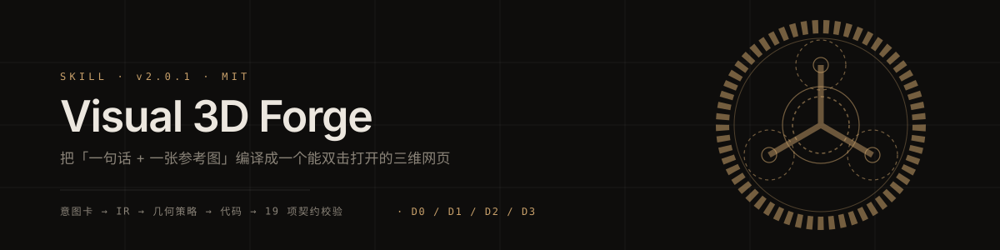

<p align="center">
  
</p>

<h3 align="center">让 AI 做 3D，失败方式极其固定：<em>能转，但不像那个物体。</em></h3>

<p align="center">
  <a href="https://github.com/LucasDevKid9/visual-3d-forge/actions/workflows/ci.yml"></a>
  <a href="LICENSE"></a>
  
  
  
</p>

<p align="center">
  <a href="https://lucasdevkid9.github.io/visual-3d-forge/"><b>▶ 在线实验台 —— 不用装任何东西，打开就能拖</b></a>
</p>

<p align="center">
  
</p>

<p align="center">
  <sub>行星齿轮减速器 · 模数 2 mm · 18 / 21 / 60 齿 · 传动比 4.33 · 全部程序化生成，无一张外部贴图</sub>
</p>

---

## 问题不在模型，在中间表示

从「一句话」直接跳到 `new THREE.Mesh(...)`，中间缺了一层：

> **这东西由哪些零件构成？每个零件多大？什么材料？谁来保证尺寸互相对得上？**

缺了这一层，模型只能去训练分布里取最像的模板——于是所有物体都长成同一个光滑的盒子：能转，但没有零件，没有比例，没有「这是被造出来的」的痕迹。

本 skill 在中间插了一道 **IR**（中间表示）。它不生成提示词，它**编译**：

<p align="center">
  
</p>

**不要先写代码，先建模型。** 这是唯一一条不能商量的顺序纪律——因为它是唯一一条能解释「为什么像」的纪律。

---

## 它和「让 GPT 写 three.js」的区别

| | 直接生成代码 | Visual 3D Forge |
|---|---|---|
| 中间产物 | 无 | 构件树 + 尺度表 + 材质假设 |
| 尺寸来源 | 训练分布里的「差不多」 | 尺度表，一处定义处处派生 |
| 参考图 | 「照着这个做」 | R1–R5 分级，决定**允许声称**的精度 |
| 失败方式 | 白屏 / 全黑 / 穿模 | 19 项静态契约拦截（附修复方向） |
| 可否否决任务 | 不会 | **G0–G4 五道闸门，任一可否决** |
| 交付物 | 一段代码 | 一个双击就能开的 `.html` |

最后一行是重点：一个只会说 yes 的流程不是流程，是模板。**G0 的出口是「不要开 WebGL」**——如果只是想让页面「动起来」，CSS 比三维正确得多。

---

## 在线实验台：改参数，看约束怎么咬人

[**lucasdevkid9.github.io/visual-3d-forge**](https://lucasdevkid9.github.io/visual-3d-forge/)

不是录屏，是真的在跑：

- 拖动模数 / 太阳轮齿数 / 内齿圈齿数，**几何真的重建**（不是等比缩放）
- 三条装配约束实时校验：**同心**（z₂ 必须整数）、**装配**（(z₁+z₃) 被 3 整除）、**邻接**（行星轮互不干涉）
- 违反约束 → 场景**拒绝重建**，停在上一组合法状态，并给出**一键修正**到最近的合法齿数
- 点击任意零件看它的作用与材料；重合度 εα 按端面啮合公式实时算

它会当着你的面拒绝一次。那一下比任何文档都能说明这个项目在做什么。

---

## 四档交付形态

| 档 | 产物 | 实测体积 | 依赖 | 何时用 |
|---|---|---|---|---|
| **D0** | 1 个 `.html` | 13 KB | 联网（CDN） | **默认** |
| **D1** | 1 个 `.html` | 2852 KB | 零 | 离线 / 内网 / U 盘 |
| **D2** | `.html` + `vendor/` | 13 KB + 2391 KB | 零 | 要可读源码 |
| **D3** | React Three Fiber 工程 | npm | 构建链 | 与 React 应用联动 |

形态由**运行环境**决定，不由「哪个更牛」决定。定了 D1 就必须真的零外部请求——校验器会逐个 URL 数。

---

## 三分钟跑起来

```bash
git clone https://github.com/LucasDevKid9/visual-3d-forge.git
cd visual-3d-forge

# 1. 直接从骨架起，不要在空文件里手写管线
cp assets/scaffold/forged-scene.html ./my-scene.html

# 2. 改成你要的物体（改的是尺度表与构件树，不是随手写 mesh）
#    规则见 references/03-geometry-modeling.md

# 3. 打包成离线单文件，然后过契约
python3 scripts/bundle.py --src ./my-scene.html --out ./offline.html --vendor ./assets/vendor
python3 scripts/validate_scene.py ./offline.html --strict
```

三个脚本全绿才允许交付。实测：13.3 KB 源 → 2851.5 KB 单文件，19 项全过，零远程引用。

> 作为 AI skill 使用：把整个目录放进宿主技能的 `skills/` 下即可，`SKILL.md` 在根。

---

## 四个工具，零第三方依赖

| 脚本 | 作用 | 真正的难点 |
|---|---|---|
| `vendor.py` | 从 three 源码裁剪依赖闭包 | 递归解析 addon 相对 import，输出带 sha256 的清单 |
| `bundle.py` | 把 vendor 内联成单文件 | **同一依赖被 import 与 re-export 各一次时必须复用 specifier**，否则 white screen |
| `api_lookup.py` | 查 API 是否真实存在 | 488 项符号表，对产物做差集并给出最接近的正确名 |
| `validate_scene.py` | 交付前静态自检 | 19 项（D1）/ 18 项（D0、D2）；`--strict` 时告警即失败 |

`bundle.py` 那条不是理论：v2.0 就死在这里——`three.module.js` 同时 `import` 与 `export from './three.core.js'`，第二次自增出一个从未注册的 `vf-int-2`，浏览器直接白屏。现在有专门的回归样本盯着它。

---

## 契约不是文档，是测试

```bash
python3 -m pytest tests/ -q     # 69 passed
```

每个数字都有一条断言能在 10 秒内证伪它：

| 层 | 断言了什么 |
|---|---|
| **文档** | frontmatter 三字段、索引与文件双向一致、无占位符、无本机绝对路径 |
| **依赖** | manifest 18 个文件逐个重算 sha256、three `REVISION = 187`、importmap 指向本地 |
| **工具** | 四个脚本 `--help` 可用、`--self-test` 通过、只 import 标准库 |
| **端到端** | D0/D2 骨架 18 项全过 → 打包 D1 → 19 项全过 → 零远程引用 → 体积落在 2.0–4.0 MB |
| **反向** | 删掉 importmap：默认只告警、`--strict` 必须变红；删 import 也必须变红 |
| **展示** | 实验台的 importmap 逐条落地、求解器三条判据在场、SVG 无脚本、GIF 不是静态图 |

反向用例是重点。**只测「对的时候对」的测试，等于没测。**

---

## 十条质量红线（命中即不合格）

> 精度谎言 · API 幻觉 · 材质分裂 · 金属度当光泽滑杆 · 装饰性物理 ·
> 默认机位 · 永动镜头 · 匀速自转当动效 · 粒子遮丑 · 多视图不一致

写成否定式清单，是因为**能被指着鼻子说「你犯了」的规范才会被执行**。

---

## 诚实边界

1. **静态检查管不了审美。** 19 项全绿 ≠ 好看。
2. **`api_lookup.py` 需要 three 源码**（`npm pack three@0.187.0`）。本包只带 build 产物，开箱时这一闸跑不起来。
3. **没有视觉回归。** 不做参考图与渲染结果的像素比对——所以「像不像」仍然要人看。
4. **`vendor/` 提交了 2.4 MB 二进制**，换来零网络、零构建的离线可用。这是交换，不是免费。
5. **技能正文为中文**，英文读者靠 `README_EN.md` 与代码结构理解。
6. **D3 只给骨架与陷阱表**，假设你会 React。
7. **实验台的齿形是长方体近似**，不是渐开线。齿数、节圆、中心距、传动比是真的，齿廓不是。

---

## 仓库结构

```
visual-3d-forge/
├── SKILL.md              契约、五闸门、六阶段、算法索引（宿主技能入口）
├── references/           13 篇按阶段查阅（3033 行：几何 / 材质 / 算法 / R3F / API 查证…）
├── assets/
│   ├── vendor/           three r187 的 18 文件裁剪集（2.4 MB，带哈希清单）
│   └── scaffold/         D0 / D2 / D3 三套骨架
├── scripts/              四个工具，纯标准库
├── playground/           在线实验台（参数化配齿 + 实时重建）
├── examples/             可运行示例（行星齿轮减速器）
├── docs/                 架构、设计笔记、验证记录、Banner 与管线图
├── tests/                69 项契约测试（含反向用例）
└── THIRD-PARTY-NOTICES.md
```

---

## 文档

- [架构：为什么它是编译器，而不是提示词](docs/ARCHITECTURE.md)
- [设计笔记：十一个决定与它们各自的反例](docs/DESIGN-NOTES.md)
- [验证记录：69 项断言分别在防什么](docs/VALIDATION.md)
- [English README](README_EN.md)

## 许可

MIT（见 [LICENSE](LICENSE)）。内置 three.js 为 MIT，见 [THIRD-PARTY-NOTICES.md](THIRD-PARTY-NOTICES.md)。
