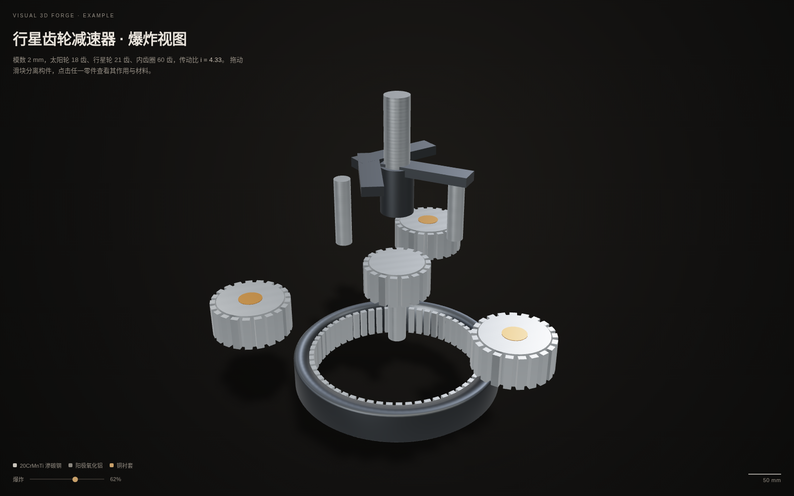

# 三维造物引擎 · visual-3d-forge

**把「一张参考图 + 一句话需求」编译成一个能双击打开的三维网页。**

[](#技术契约)
[](#验证)
[](#四档交付形态)
[](LICENSE)



<sub>示例：`examples/planetary-gear-3d/`，模数 2 mm，18/21/60 齿，传动比 4.33，爆炸 62%。全部程序化生成，无外部贴图。</sub>

---

## 它解决什么问题

让 AI 做 3D，失败方式非常固定：**能转，但不像那个物体**。
原因不在模型不够强，而在**中间表示缺失**——从「一句话」直接跳到 `new THREE.Mesh`，
中间没有「这东西由哪些零件构成、每个零件多大、什么材料」这一层。
没有这一层，模型只能取训练分布里最像的模板，于是所有物体都长成同一个光滑的盒子。

本 skill 在中间插了一道 IR：

```
需求 ──▶ 意图卡 ──▶ 构件树 + 尺度表 + 材质假设 ──▶ 几何策略 ──▶ 代码 ──▶ 19 项校验
                       └────────── IR ──────────┘
```

**不要先写代码，先建模型。** 这是唯一一条不能商量的顺序纪律。

---

## 四档交付形态

| 档 | 产物 | 实测体积 | 依赖 | 何时用 |
|---|---|---|---|---|
| **D0** | 1 个 `.html` | 13 KB | 联网（jsDelivr） | **默认** |
| **D1** | 1 个 `.html` | 2852 KB | 零 | 离线 / 内网 / U 盘 |
| **D2** | `.html` + `vendor/` | 13 KB + 2391 KB | 零 | 要可读源码 |
| **D3** | React Three Fiber 工程 | npm | 构建链 | 与 React 应用联动 |

形态由运行环境决定，不由「哪个更牛」决定。定了 D1 就必须真的零外部请求——校验器会查。

---

## 五个启动闸门

写第一行代码之前依次通过；**任何一关可以否决整个任务**。

| 闸 | 问题 | 否决的情形 |
|---|---|---|
| **G0 载体** | 真的需要第三维吗 | 只是想「动起来」→ 用 CSS / 2D |
| **G1 意图** | 意图卡七字段齐了吗 | 对象/目的/受众/尺度/必须有/可舍弃/形态，缺一不算过 |
| **G2 参考** | 参考属于 R1–R5 哪一级 | R3 以下禁止声称「精确还原」 |
| **G3 预算** | 面数与绘制调用定档了吗 | 网页场景不需要几十万面 |
| **G4 依赖** | 这份要跑在哪里 | 离线场景却选了 CDN 档 |

`G0` 的出口是「**不要开 WebGL**」。一个只会说 yes 的流程不是流程，是模板。

---

## 快速开始

```bash
# 0. 装：把整个目录放进宿主技能的 skills/ 下即可（SKILL.md 在根）

# 1. 定形态（读 references/00-delivery-modes.md 的决策树）
#    假设判定为 D1（离线单文件）

# 2. 从骨架起，不要在空文件里手写管线
cp assets/scaffold/forged-scene.html ./task-x01/scene.html

# 3. 改主体 → 打包 → 查 API → 校验
python3 scripts/bundle.py --src ./task-x01/scene.html --out ./task-x01/offline.html --vendor ./assets/vendor
python3 scripts/validate_scene.py ./task-x01/offline.html --strict
```

三个脚本全绿才允许交付。实测：13.3 KB 源 → 2851.5 KB 单文件，19 项全过，零远程引用。

---

## 四个工具

| 脚本 | 作用 | 关键点 |
|---|---|---|
| `scripts/vendor.py` | 从 three 源码裁剪依赖 | 递归解析 addon 相对 import 闭包，输出带 sha 的 `manifest.json` |
| `scripts/bundle.py` | 把 vendor 内联成单文件 | **递归内联相对闭包并改写为 `vf-int-N`**，否则 data URL 里 `./three.core.js` 解析失败 → 白屏 |
| `scripts/api_lookup.py` | 查 API 是否真实存在 | 符号表 488 项，`check` 对产物做差集并给出最接近的正确名 |
| `scripts/validate_scene.py` | 交付前静态自检 | 19 项（D1）/ 18 项（D0、D2）；`--strict` 时告警即失败 |

---

## 仓库结构

```
visual-3d-forge/
├── SKILL.md              契约、五闸门、六阶段、算法索引（宿主技能入口）
├── references/           13 篇按阶段查阅的参考（几何 / 材质 / 算法 / R3F / API 查证…）
├── assets/
│   ├── vendor/           three 0.187.0 的 18 文件裁剪集（2.4 MB，带哈希清单）
│   └── scaffold/         D0 / D2 / D3 三套骨架
├── scripts/              四个工具，纯标准库，零第三方依赖
├── examples/             可运行的示例（行星齿轮减速器）
├── docs/                 架构、设计笔记、验证记录
├── tests/                26 项契约测试
└── THIRD-PARTY-NOTICES.md
```

---

## 验证

```bash
python3 -m pytest tests/ -q        # 26 passed
```

测试不是「跑通就算」，而是**把这个 skill 的承诺变成可证伪的断言**：

| 层 | 断言了什么 |
|---|---|
| 文档 | frontmatter 三字段、索引与文件双向一致、无占位符、无本机绝对路径 |
| 依赖 | manifest 18 个文件逐个重算 sha256、three REVISION = 187、importmap 指向本地 |
| 工具 | 四个脚本 `--help` 可用、`bundle --self-test` / `vendor --self-test` 通过、只用标准库 |
| 端到端 | D0/D2 骨架校验 18 项全过 → 打包 D1 → 19 项全过 → 零远程引用 → 体积 2.0–4.0 MB |
| 反向 | 删掉 importmap 后，默认只告警、`--strict` 必须变红 |

详细记录见 [`docs/VALIDATION.md`](docs/VALIDATION.md)。

---

## 十条质量红线（命中即不合格）

精度谎言 · API 幻觉 · 材质分裂 · 金属度当光泽滑杆 · 装饰性物理 ·
默认机位 · 永动镜头 · 匀速自转当动效 · 粒子遮丑 · 多视图不一致

写成否定式清单，是因为**能被指着鼻子说「你犯了」的规范才会被执行**。

---

## 诚实边界

1. **静态检查管不了审美。** 19 项全绿 ≠ 好看。
2. **`api_lookup.py` 需要 three 源码**（`npm pack three@0.187.0`）。本包只带 build 产物，开箱时这一闸跑不起来。
3. **没有视觉回归。** 不做参考图与渲染结果的像素比对。
4. **`vendor/` 提交了 2.4 MB 二进制**，换来零网络、零构建的离线可用。
5. **技能正文为中文**，英文读者只能靠 `README_EN.md` 与代码结构理解。
6. **D3 只给骨架与陷阱表**，假设你会 React。

---

## 文档

- [架构：为什么它是编译器](docs/ARCHITECTURE.md)
- [设计笔记：十一个决定与反例](docs/DESIGN-NOTES.md)
- [验证记录](docs/VALIDATION.md)
- [English README](README_EN.md)

## 许可

MIT（见 [LICENSE](LICENSE)）。内置 three.js 为 MIT，见 [THIRD-PARTY-NOTICES.md](THIRD-PARTY-NOTICES.md)。
