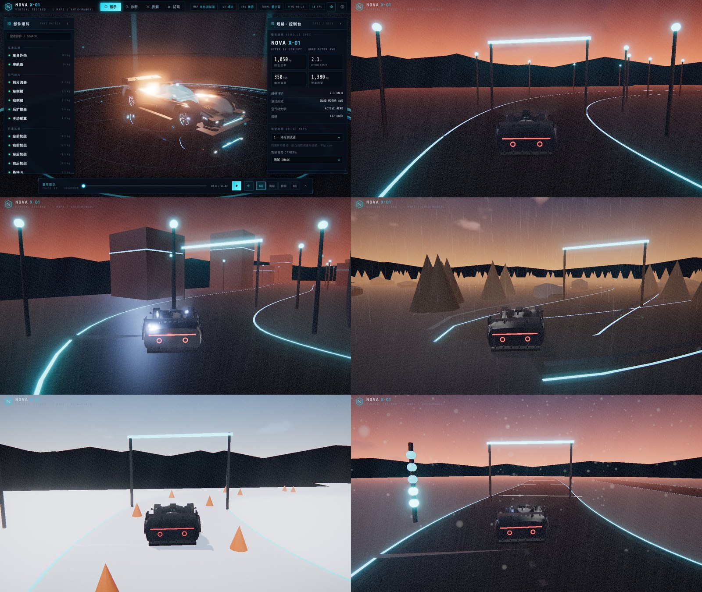
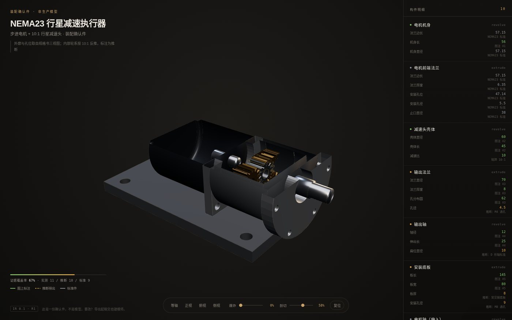
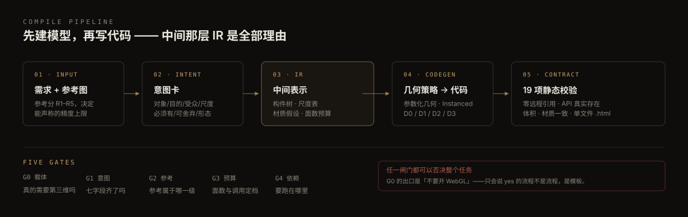
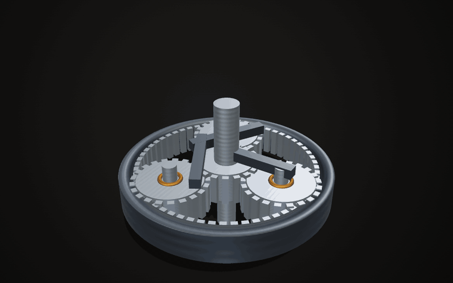

<p align="center">
  
</p>

<h3 align="center">让 AI 做 3D，失败方式极其固定：<em>能转，但不像那个物体。</em></h3>

<p align="center">
  <a href="https://github.com/LucasDevKid9/visual-3d-forge/actions/workflows/ci.yml"></a>
  <a href="LICENSE"></a>
  
  
  
  <a href="https://github.com/LucasDevKid9/visual-3d-forge/stargazers"></a>
  <a href="https://github.com/LucasDevKid9/visual-3d-forge/network/members"></a>
  <a href="https://github.com/LucasDevKid9/visual-3d-forge/issues"></a>
  <a href="https://github.com/LucasDevKid9/visual-3d-forge"></a>
  <a href="https://github.com/LucasDevKid9/visual-3d-forge/commits/main"></a>
</p>

<p align="center">
  <a href="https://lucasdevkid9.github.io/visual-3d-forge/"><b>▶ 在线体验 · NOVA X-01 —— 五场景虚拟试验台，打开就能开</b></a>
</p>

<p align="center">
  <a href="https://lucasdevkid9.github.io/visual-3d-forge/">
    
  </a>
</p>

<p align="center">
  <sub>NOVA X-01 · 单文件 673 KB · 双击即开，不用服务器 · 3D 全离线（字体可选联网，断网自动回退系统字体） · 5 场景 / 4 时段 / 3 天气 / 四档交付</sub>
</p>

---

## ✨ 亮点速览

| | |
|---|---|
| 🏗️ **编译，而不是拼提示词** | 六道闸门 + IR 构件树，先建模型再写代码；跳过建模直接 `new THREE.Mesh` 是本项目明令禁止的起点 |
| 📐 **每个尺寸可追溯** | 实测 / 标准 / 推断三成色着色，每个数值钉回几何段，钉不上就报「未定位」 |
| 🎯 **四档交付 D0–D3** | CDN 单文件 · 全离线单文件 · HTML+vendor 目录 · React Three Fiber 工程，按运行环境选档 |
| 🧪 **204 项契约测试** | 含反向用例：删 importmap、删 import 必须变红；文档 / 依赖 / 工具 / 端到端四层断言 |
| 📦 **零运行时依赖** | 十个脚本纯 Python 标准库；离线包是 2.4 MB 裁剪后的 three r187 精选集，带哈希清单 |
| 🌐 **中英双语文档** | README 与核心文档成对存在，结构对齐；英文读者不靠猜中文代码注释理解 |

---

## Spec Compiler：把一张带标注的图，编译成一个能转的确认件

NOVA 回答「这套管线能做出什么」；Spec Compiler 回答「**规格怎么变成能转的东西**」。

它不做建模，做**确认**——项目时间轴上「建模之前」那一格，目前没有任何工具：

```
  概念          规格         【确认】         建模          渲染         交付
   │             │              │              │             │            │
  草图          图纸/参数        ???          Blender        C4D        成片
                               ↑
                          这一格是空的
```

Blender 放大人的手艺；这里要消灭的是「翻译」这个动作。人只做**指认**——这是什么件、几个数、装在哪——位置由装配链求解，几何由五个基元（回转 / 拉伸 / 齿形 / 阵列 / 孔）生成。

<p align="center">
  <a href="https://lucasdevkid9.github.io/visual-3d-forge/spec/out/nema23-actuator.html"><b>▶ 在线打开这份确认件 —— 能转、能剖、能炸开</b></a>
</p>

<p align="center">
  
</p>

### 每个数字都必须交代来源

产物里的每一根描边按**成色**着色，右侧明细逐条列出出处：

| 成色 | 含义 | 页面上的表现 |
|---|---|---|
| **实测** | 图上有明确标注 | 绿线 · 悬停显示图注编号 |
| **标准** | 取自 NEMA / GB / ISO | 灰线 · 显示标准号 |
| **推断** | 按比例、对称或先验得出，**未经图纸确认** | 琥珀线 · 悬停显示依据 |

没有任何一个建模工具会告诉你「这个数是我猜的」，因为那不利于卖软件。但签收的人只关心这一句。

<p align="center">
  
</p>

### 每个数字都钉在它量过的那一段上

<p align="center">
  
</p>

「有依据」如果只是一句话，它就没法被检验。所以编译器会把每个尺寸**钉回几何**：人去量包围盒、量轮廓段、量孔心距，钉不上的一律报「未定位」。

```
  机身长    56.0  →  motor_body 的 X 跨度 56.00  ✓
  机身直径  57.15 →  motor_body 的径向直径 57.15 ✓
  扁位直径  10.0  →  轮廓里 r=5.0 那一段的 2r     ✓
  安装孔径  5.5   →  motor_flange 的四个 ⌀5.5 孔 ✓
  孔分布圆  62.0  →  六个孔心两两距离 62.00      ✓
  齿数      16    →  无量纲，不参与定位（分母扣除）
```

页面里这些落点变成真正的尺寸线：引出线、箭头、数值、按成色着色。鼠标停在某个件上，这个件的尺寸全部亮起；在右侧点一条明细，相机飞过去、对应的那段亮到全屏只剩它。

> 这条链能抓自己的错。第一版它报出了「壳体长填 45、几何是 46」——两个数字都不假，只是不一致。**这种错，人眼在渲染图里看不出来。**

### 一条命令，三个产物

```bash
python3 tools/spec_compile.py spec/examples/nema23-actuator.yaml --out spec/out/
```

```
  NEMA23 行星减速执行器  ·  10 构件  ·  指纹 468d2f13e6ba4b1d
  ──────────────────────────────────────────────────────────────
  [PASS] C1  同轴          所有 coax 约束的横向偏移为 0（≤0.5 mm）
  [PASS] C2  贴合间隙      4 处贴合，最大偏差 0.000 mm
  [PASS] C3  孔位在轮廓内   所有孔洞均落在轮廓内，无越界
  [PASS] C4  包围盒干涉    无未声明干涉（贴合对与内部件已排除）
  [PASS] C5  证据覆盖率    可信 67%（实测 11 + 标准 9）/ 共 30 项
  [PASS] C6  证据定位率    26/26 项尺寸已在几何上定位（容差 0.8 mm / 2%）
  ──────────────────────────────────────────────────────────────
```

| 产物 | 给谁 | 解决什么 |
|---|---|---|
| `*.html` | 客户 / 老板 / 销售 | 30 秒看懂，能转、能剖、能量 |
| `*.report.html` + `*.ir.json` | 项目 / 质量 | 哪些数对上了，哪些是推断，误差多少 |
| IR | 建模师（后续导出 glTF） | 不用从零开始，改细节就行 |

同一份 SpecSheet 编译两次，指纹必须一致——这条写进了 `tests/test_spec.py`：**改一个数指纹就变，不改就永远一样**。

- 输入契约：[`spec/schema/specsheet.schema.json`](spec/schema/specsheet.schema.json)
- 示例规格表：[`spec/examples/nema23-actuator.yaml`](spec/examples/nema23-actuator.yaml)
- 路线与边界：[`docs/ROADMAP.md`](docs/ROADMAP.md) —— 26 周，四个阶段，每阶段一个可证伪判据
- 交付标准：[`docs/PRINCIPLES.md`](docs/PRINCIPLES.md) —— 十条工程原则 + 反面清单，可逐条否证
- 文档地图：[`docs/README.md`](docs/README.md) —— 中英对照索引与阅读顺序

---

## 问题不在模型，在中间表示

从「一句话」直接跳到 `new THREE.Mesh(...)`，中间缺了一层：

> **这东西由哪些零件构成？每个零件多大？什么材料？谁来保证尺寸互相对得上？**

缺了这一层，模型只能去训练分布里取最像的模板——于是所有物体都长成同一个光滑的盒子：能转，但没有零件，没有比例，没有「这是被造出来的」的痕迹。

本 skill 在中间插了一道 **IR**（中间表示）。它不生成提示词，它**编译**：

<p align="center">
  
</p>

**不要先写代码，先建模型。** 这是唯一一条不能商量的顺序纪律——因为它是唯一一条能解释「为什么像」的纪律。

---

## 它和「让 GPT 写 three.js」的区别

| | 直接生成代码 | Visual 3D Forge |
|---|---|---|
| 中间产物 | 无 | 构件树 + 尺度表 + 材质假设 |
| 尺寸来源 | 训练分布里的「差不多」 | 尺度表，一处定义处处派生 |
| 参考图 | 「照着这个做」 | R1–R5 分级，决定**允许声称**的精度 |
| 失败方式 | 白屏 / 全黑 / 穿模 | 19 项静态契约拦截（附修复方向） |
| 可否否决任务 | 不会 | **G0–G5 六道闸门，任一可否决** |
| 交付物 | 一段代码 | 一个双击就能开的 `.html` |

最后一行是重点：一个只会说 yes 的流程不是流程，是模板。**G0 的出口是「不要开 WebGL」**——如果只是想让页面「动起来」，CSS 比三维正确得多。

---

## 旗舰示例：NOVA X-01

上面那张图不是渲染图，是一个 **673 KB 的 HTML 文件**的截图。

打开它，你会看到：一辆程序化生成的概念车、五张可切换的场景、四个时段、三种天气、一套拆解视图和一套规格控制台。全程 60 fps，无外部贴图、无模型文件、无构建步骤。

**为什么它值得单独做一个示例：**

| 常规 demo | 这个示例 |
|---|---|
| 一个模型，转一圈 | 五个场景，每个都有自己的光照与大气 |
| 展示"能生成" | 展示"换场景不换质量" |
| 源码和产物混在一起 | **只发产物，不发源码**——它是编译器吐出来的东西，不是一个可以抄的模板 |

产物在 [`demo/index.html`](demo/index.html)，673 KB 单文件。源码不随仓库分发，这是刻意的：**交付物是产物，不是源码。**

场景构成：

| # | 场景 | 在验证什么 |
|---|---|---|
| 1 | 展台（SHOWROOM） | 无缝影棚、五档曝光、部件矩阵、爆炸视图 |
| 2 | 环形测试道 | 弯道跟随、低角度追尾、连续光照 |
| 3 | 城市夜街 | 楼群遮挡、湿地面反射、夜间泛光 |
| 4 | 山地弯道 | 地形起伏、远景层次、雨雾衰减 |
| 5 | 冰雪试验场 | 低附着路面、桩桶阵、高反照率地面 |
| 6 | 直线加速道 | 速度感、长焦压缩、制动距离 |

按 `N` 换地图，`C` 换视角，`T` 换时段，`F` 换天气，`Space` 拆解。或者在网址后面加 `?tour=1`，它会把五个场景自己串成一条片子。

---

## 在线实验台：改参数，看约束怎么咬人

[**lucasdevkid9.github.io/visual-3d-forge/playground/**](https://lucasdevkid9.github.io/visual-3d-forge/playground/)

<p align="center">
  
</p>

不是录屏，是真的在跑：

- 拖动模数 / 太阳轮齿数 / 内齿圈齿数，**几何真的重建**（不是等比缩放）
- 三条装配约束实时校验：**同心**（z₂ 必须整数）、**装配**（(z₁+z₃) 被 3 整除）、**邻接**（行星轮互不干涉）
- 违反约束 → 场景**拒绝重建**，停在上一组合法状态，并给出**一键修正**到最近的合法齿数
- 点击任意零件看它的作用与材料；重合度 εα 按端面啮合公式实时算

它会当着你的面拒绝一次。那一下比任何文档都能说明这个项目在做什么。

---

## 四档交付形态

| 档 | 产物 | 实测体积 | 依赖 | 何时用 |
|---|---|---|---|---|
| **D0** | 1 个 `.html` | 13 KB | 联网（CDN） | **默认** |
| **D1** | 1 个 `.html` | 2852 KB | 零 | 离线 / 内网 / U 盘 |
| **D2** | `.html` + `vendor/` | 13 KB + 2391 KB | 零 | 要可读源码 |
| **D3** | React Three Fiber 工程 | npm | 构建链 | 与 React 应用联动 |

形态由**运行环境**决定，不由「哪个更牛」决定。定了 D1 就必须真的零外部请求——校验器会逐个 URL 数。

---

## 三分钟跑起来

```bash
git clone https://github.com/LucasDevKid9/visual-3d-forge.git
cd visual-3d-forge

# 1. 直接从骨架起，不要在空文件里手写管线
#    要打包离线单文件，必须用 vendor 骨架（CDN 版的 importmap 是远程地址，无法内联）
cp assets/scaffold/forged-scene.vendor.html ./my-scene.html

# 2. 改成你要的物体（改的是尺度表与构件树，不是随手写 mesh）
#    规则见 references/03-geometry-modeling.md

# 3. 打包成离线单文件，然后过契约
python3 scripts/bundle.py --src ./my-scene.html --out ./offline.html --vendor ./assets/vendor
python3 scripts/validate_scene.py ./offline.html --strict
```

三个脚本全绿才允许交付。实测：13.3 KB 源 → 2851.5 KB 单文件，19 项全过，零远程引用。

> 作为 AI skill 使用：把整个目录放进宿主技能的 `skills/` 下即可，`SKILL.md` 在根。

---

## 十一个工具，零第三方依赖

| 脚本 | 作用 | 真正的难点 |
|---|---|---|
| `vendor.py` | 从 three 源码裁剪依赖闭包 | 递归解析 addon 相对 import，输出带 sha256 的清单 |
| `bundle.py` | 把 vendor 内联成单文件 | **同一依赖被 import 与 re-export 各一次时必须复用 specifier**，否则 white screen |
| `api_lookup.py` | 查 API 是否真实存在 | 488 项符号表，对产物做差集并给出最接近的正确名 |
| `validate_scene.py` | 交付前静态自检 | 19 项；压缩产物按产物类型跳过计数类检查 |
| `validate_experience.py` | 体验完整性自检 | 23 项：状态机、幕结构、引导、声音、反馈、无障碍 |
| `timeline_check.py` | 提示表数据层自检 | 13 条：主时钟唯一、cue 不越界/不重号、降级降结构 |
| `export_mht.py` | 产物封成 `.mht` 归档 | 写明「MHTML 是容器不是运行时」的边界 |
| `mht_unpack.py` | 拆开别人发来的 `.mht` | 与上一个方向相反：取件而非交付；推断存盘时漏掉的资源 |
| `experience_plan.py` | 需求 → 体验蓝图 | 六段式填表、幕表、张力曲线、时间栅格 |
| `build_standalone.py` | 把任意页面压成离线单文件 | 递归内联 module 与 addons，IIFE 化后不残留任何 `import` |
| `forge_init.py` | 从骨架初始化工程 | — |

`bundle.py` 那条不是理论：v2.0 就死在这里——`three.module.js` 同时 `import` 与 `export from './three.core.js'`，第二次自增出一个从未注册的 `vf-int-2`，浏览器直接白屏。现在有专门的回归样本盯着它。

---

## 契约不是文档，是测试

```bash
python3 -m pytest tests/ -q     # 204 passed
```

每个数字都有一条断言能在 10 秒内证伪它：

| 层 | 断言了什么 |
|---|---|
| **文档** | frontmatter 三字段、索引与文件双向一致、无占位符、无本机绝对路径 |
| **依赖** | manifest 18 个文件逐个重算 sha256、three `REVISION = 187`、importmap 指向本地 |
| **工具** | 五个脚本 `--help` 可用、`--self-test` 通过、只 import 标准库 |
| **端到端** | D0/D2 骨架 18 项全过 → 打包 D1 → 19 项全过 → 零远程引用 → 体积落在 2.0–4.0 MB |
| **反向** | 删掉 importmap：默认只告警、`--strict` 必须变红；删 import 也必须变红 |
| **展示** | 实验台的 importmap 逐条落地、求解器三条判据在场、SVG 无脚本、GIF 不是静态图 |

反向用例是重点。**只测「对的时候对」的测试，等于没测。**

---

## 十五条质量红线（命中即不合格）

> **形体层**：精度谎言 · API 幻觉 · 材质分裂 · 金属度当光泽滑杆 · 装饰性物理 ·
> 默认机位 · 永动镜头 · 匀速自转当动效 · 粒子遮丑 · 多视图不一致
>
> **体验层**（v2.8 新增五条）：体验外衣 · 动词空转 · 沉默交互 · 无出口 · 加载即黑屏

写成否定式清单，是因为**能被指着鼻子说「你犯了」的规范才会被执行**。

前十条守的是「像不像那个物体」，后五条守的是「里面有没有人在做事」。
一个页面可以十项全绿，仍然是**加了转场动画的说明书**——后五条就是拦这个的。
逐条判据与反例见 [`SKILL.md`](SKILL.md) 第七章。

---

## 诚实边界

1. **静态检查管不了审美。** 19 项全绿 ≠ 好看。
2. **`api_lookup.py` 需要 three 源码**（`npm pack three@0.187.0`）。本包只带 build 产物，开箱时这一闸跑不起来。
3. **没有视觉回归。** 不做参考图与渲染结果的像素比对——所以「像不像」仍然要人看。
4. **`vendor/` 提交了 2.4 MB 二进制**，换来零网络、零构建的离线可用。这是交换，不是免费。
5. **技能正文为中文**，英文读者靠 `README_EN.md` 与代码结构理解。
6. **D3 只给骨架与陷阱表**，假设你会 React。
7. **实验台的齿形是长方体近似**，不是渐开线。齿数、节圆、中心距、传动比是真的，齿廓不是。

---

## ❓ 常见问题

**Q：需要安装 three.js 或构建工具吗？**
D0 / D1 / D2 不需要 npm：依赖要么走 CDN，要么已经内联进 `vendor/`。只有 D3（React Three Fiber 工程）才需要 Vite + React 工具链。

**Q：能加载我自己的模型和贴图吗？**
可以。加载器覆盖 GLTF / OBJ / STL / PLY / SVG / Font / RGBE；DRACO、KTX2、FBX 为按需插件。外部模型、贴图、音频、视频资产必须随包或提供占位，离线版本不会在代码里伪造一个加载不出来的路径。

**Q：能做游戏、动画、工艺流程展示吗？**
能。展示型确认件走 `spec/` 编译器；体验型（游戏手感、叙事动画、引导、声音反馈）走 `references/18`–`21` 四篇体验文档与 `experience-shell.html` 骨架。

**Q：支持物理碰撞和刚体模拟吗？**
物理后端（Rapier / Ammo / Jolt）依赖运行时 WASM，按需接入，不打进离线包；离线演示用质点弹簧与 Verlet 积分降级，边界写在 `references/23` 覆盖矩阵里。

**Q：怎么把它装成一个 AI 技能？**
把整个目录放进宿主技能的 `skills/` 下即可，入口是根目录的 `SKILL.md`。技能目录名必须与 frontmatter 的 `name` 一致（`visual-3d-forge`），契约测试会核对这一点。

**Q：`api_lookup.py` 为什么在本机跑不起来？**
它需要 three.js 源码包（`npm pack three@0.187.0`）；仓库只带 build 产物与裁剪后的 vendor，开箱时这一闸跳过，属已知边界。

---

## 仓库结构

```
visual-3d-forge/
├── SKILL.md              契约、六闸门、八阶段、算法索引（宿主技能入口）
├── references/           24 篇按阶段查阅（几何 / 材质 / API / 离线 / R3F / 体验 / 官方示例图谱…）
├── prompts/              资深专家协作协议 v2.0（可粘贴紧凑版 + 逐条映射）
├── assets/
│   ├── vendor/           three r187 的 18 文件裁剪集（2.4 MB，带哈希清单）
│   └── scaffold/         D0 / D2 / D3 三套骨架
├── scripts/              十一个工具，纯标准库
├── demo/                 旗舰示例 NOVA X-01（构建产物，673 KB 单文件，源码不随仓库分发）
├── playground/           在线实验台（参数化配齿 + 实时重建）
├── examples/             可运行示例（行星齿轮减速器）
├── spec/                 SpecSheet schema、编译器、运行时、示例与产物
│   ├── schema/           输入契约（jsonschema）
│   ├── runtime/          viewer.js：枢轴、尺寸线、拾取、取景
│   ├── examples/         NEMA23 装配确认件源文件
│   └── out/              编译产物（可交互 HTML / IR / 报告）
├── tools/                spec_compile.py：YAML → IR → 单文件确认件
├── guide/                给人用的引导层：六份可填模板 + 一条走通的记录
├── docs/                 架构、设计笔记、验证记录、Banner 与管线图
├── tests/                204 项契约测试（含反向用例）
└── THIRD-PARTY-NOTICES.md
```

---

## 文档

**第一次上手，先看这一份**：[引导：从一张图到一件成品](guide/README.md) —— 需求表、读图、规格书、验收、诊断、体验取舍，六份可填模板加一条走通的路。

- [工程原则：十条准则与反面清单](docs/PRINCIPLES.md) —— [English](docs/PRINCIPLES_EN.md)
- [路线：26 周四个阶段，每阶段一个可证伪判据](docs/ROADMAP.md) —— [English](docs/ROADMAP_EN.md)
- [战略：护城河、算法排序、商业顺序](docs/STRATEGY-2026.md) —— [English](docs/STRATEGY-2026_EN.md)
- [技术白皮书：架构、可追溯性与未来演进](README.zh-CN.md)
- [文档地图与阅读顺序](docs/README.md)
- [架构：为什么它是编译器，而不是提示词](docs/ARCHITECTURE.md)
- [设计笔记：十一个决定与它们各自的反例](docs/DESIGN-NOTES.md)
- [验证记录：204 项断言分别在防什么](docs/VALIDATION.md)
- [能力地图：three.js 的 620 个示例我们取哪几个，以及为什么不全取](docs/CAPABILITY-MAP.md)
- [资深专家协作协议：Systematic Prompt v2.0](prompts/systematic-prompt.md)
- [English README](README_EN.md)

## 🤝 社区与贡献

欢迎 Issue 与 PR：报告 API 幻觉案例、补充领域剧本、提交可复现的失败场景，都是高价值贡献。

- [新建 Issue / 功能建议](https://github.com/LucasDevKid9/visual-3d-forge/issues/new/choose) · [开放中的 Issue](https://github.com/LucasDevKid9/visual-3d-forge/issues)
- [贡献指南](CONTRIBUTING.md) · [行为准则](CODE_OF_CONDUCT.md) · [安全策略](SECURITY.md)
- [变更日志](CHANGELOG.md) · [第三方声明](THIRD-PARTY-NOTICES.md)

<p align="center">
  <a href="https://github.com/LucasDevKid9/visual-3d-forge">
    
  </a>
</p>

## 许可

MIT（见 [LICENSE](LICENSE)）。内置 three.js 为 MIT，见 [THIRD-PARTY-NOTICES.md](THIRD-PARTY-NOTICES.md)。
