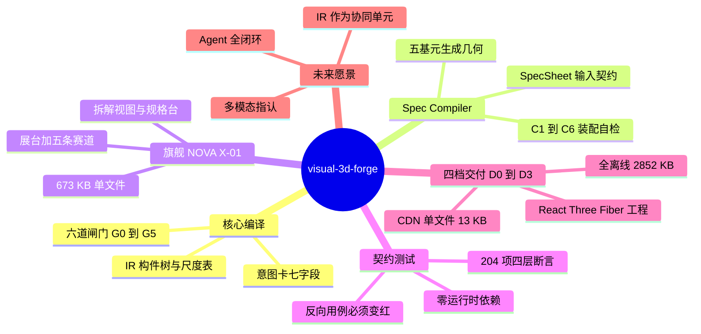
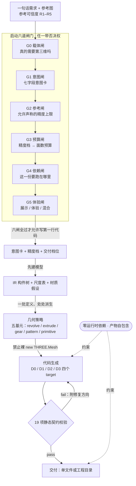
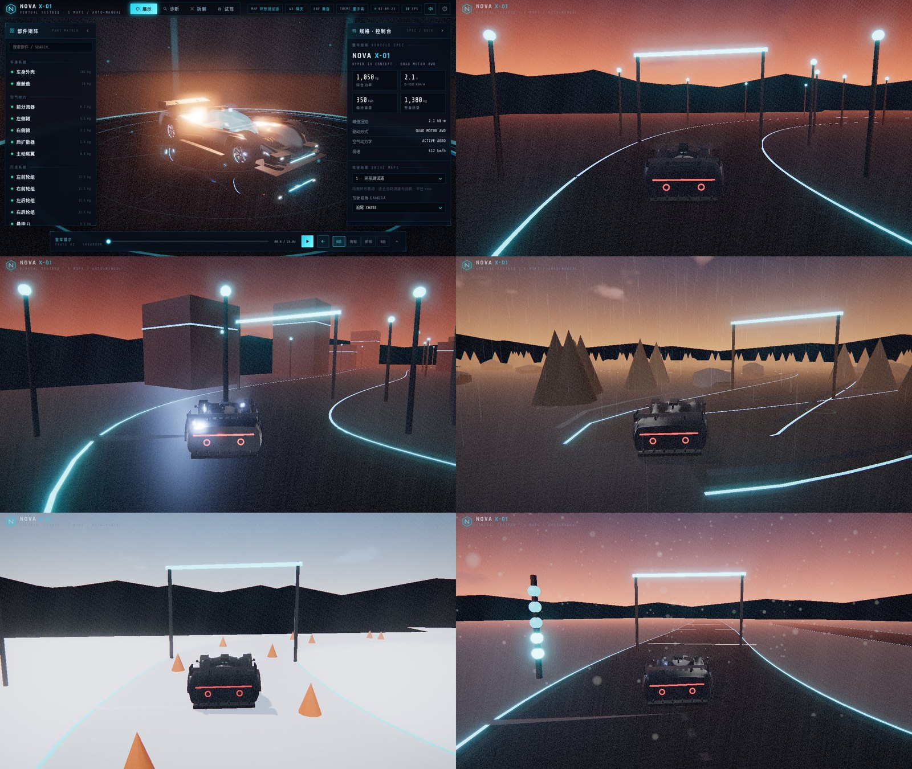

<p align="center"><b>简体中文</b> · <a href="README_EN.md">English</a ></p >

# Visual 3D Forge · 技术白皮书

> **让 AI 做 3D，失败方式极其固定：能转，但不像那个物体。本项目用编译管线解决这个问题。**

输入一句话和一张参考图，输出一个双击就能打开、每个尺寸都能说出出处、并被 204 项断言担保过的 `.html`。中间不写提示词，走编译。

---

## 本文的成色

这个项目为每个尺寸定义了三种成色：**实测 / 标准 / 推断**。本文沿用同一制度约束自己——因为一份讲「每个数字都要交代来源」的文档，若自己不交代，它就没有资格讲这件事。

| 成色 | 定义 | 本文中的表现 |
|---|---|---|
| **实测** | 有仓库内命令可复跑，结果可复现 | 附命令或直接给出产物路径 |
| **标准** | 取自外部规范（NEMA / GB / ISO）或上游版本号 | 标注出处 |
| **推断** | 本文作者的判断，未经数据验证 | 显式标注「推断」 |

第九节整节是推断。其余各节的体积、计数、断言结论，都能用仓库里的脚本重新跑一遍得到同一个数。

---

## 一、中心命题：为什么编译优于拼提示词

### 1.1 缺的不是生成能力，是中间表示

从「做一辆概念车」直接跳到 `new THREE.Mesh(...)`，中间缺了一层东西：

> **这东西由哪些零件构成？每个零件多大？什么材质？谁保证它们的尺寸互相对得上？**

缺了这一层，模型只能去训练分布里取最像的模板。于是失败方式收敛成同一个：**能转，但不像那个物体**——所有东西都长成一个光滑的盒子，没有零件、没有比例、没有「被造出来」的痕迹。

关键在于：这不是「模型不够强」的问题。**再强的生成能力也不会自动产生单一事实来源。** 一句「长 56mm」，在渲染代码里会以至少三种形态出现：几何参数的 56、相机距离的估算、标注文字的 "56.0"。三处一旦漂移，画面依然好看，产品依然错的。

编译器解决的就是这个：把 56 变成一个**只能定义一次、处处派生**的节点，然后拒绝任何不一致。

### 1.2 六道闸门：一个允许自己说「不」的流程

写第一行代码之前，必须先过六道闸。它们不是检查清单，是**否决权**：

| 闸 | 问的问题 | 典型否决理由 |
|---|---|---|
| **G0** 载体闸 | 这件事真的需要第三维吗 | 只是想让页面「动起来」→ 用 CSS，别开 WebGL |
| **G1** 意图闸 | 意图卡七个字段填得出来吗 | 「好看一点」无法验收 → 打回重问 |
| **G2** 参考闸 | 参考图可信到什么级别（R1–R5） | 只有一张模糊的照片 → 不许声称「1:1 还原」 |
| **G3** 预算闸 | 精度档定在哪，面数预算多少 | 要 0.5mm 级装配精度，却要求 60 fps 且不降级 → 冲突 |
| **G4** 依赖闸 | 这份要跑在哪里 | 内网离线却给了 CDN 方案 → 换档 |
| **G5** 体验闸 | 这是展示、体验，还是混合 | 判定为展示型 → 跳过 E1/E2 是**判定**，不是遗忘 |

最后一行是这套设计的重心：**G0 的出口可以是「不要做三维」。** 一个只会说 yes 的流程不是流程，是模板；而模板的成本永远由下游承担。

六道闸对应八阶段主流程的前置条件——闸不过，阶段不许开始。这是顺序纪律，不是建议。

### 1.3 为什么明令禁止直接 `new THREE.Mesh`

这条禁令看着像洁癖，实际是四个不可逆损失：

**一、尺度不可派生。** 硬编码的 `0.56` 是一次性常量。改整体比例时，你要去找散落在 20 处的 0.56。尺度表把这件事变成改一处。

**二、干涉不可检测。** 没有构件树，就没有「装配关系」这个概念，也就无从判断四个 ⌀5.5 的孔有没有落在法兰轮廓内。C3 需要「轮廓」，C4 需要「已声明的贴合对与内部件」——这两个前提在裸 mesh 的世界里都不存在。

**三、变更不可传播。** 尺寸是关系，不是数字。孔位从 47.14 改到 50，安装底板、内部让位、线缆出口都应跟着动。裸 mesh 不会传播任何东西。

**四、产物不可验证——这一条最致命。** 一个 `new THREE.Mesh(geometry, material)` 调用**没有地址**。它没有稳定 ID，没有名字，没有可以被外部工具引用、被尺寸线指向、被报告条目关联的句柄。于是「26/26 项尺寸已在几何上定位」这种断言**无法存在**：没有地址，就没有落点，也就没有可检验性。

> 第四点决定了整个项目的形状：**可追溯性不是给模型加的功能，是给模型加地址的结果。**

---

## 二、系统架构



六个分支不是并列关系。中间四个是架构层，上下两个分别是它的物证与去向：

- **核心编译**是前端与中端：把「模糊」压成「可计算」。三个装置分别是意图卡（七字段）、参考分级（R1–R5，给精度定一个可辩护的上限）、尺度表（一处定义、处处派生）。
- **Spec Compiler** 是同一条编译链的第二入口：输入不是参考图 + 一句话，而是一份带标注的规格表。
- **旗舰 NOVA X-01** 是能力上限的物证，也是「只发产物、不发源码」这条纪律的样本。
- **契约测试**是验证层，也是唯一能让上面三件事「可被否证」的机制。
- **四档交付**是后端：四个 codegen target，由运行环境决定，不由「哪个更牛」决定。
- **未来愿景**见第九节，整节为推断。

---

## 三、编译管线



三条约束画在边上，但它们的实际位置在心里：

**六闸门是前置的，不是并行的。** 它们全部发生在写代码之前。事后补救在这里不被承认——校验器只能证伪，不能替代判断。

**「零运行时依赖」不是优化项，是产物定义的一部分。** 它约束 codegen target 的选择：一旦定 D1，产物里就不允许出现任何外部 URL，校验器会逐个 `grep` 计数。

**回退边是单向的。** 校验失败必须回到代码生成，不允许回到闸门去改判定——否则「过闸」就变成了可协商的。

### 八阶段与两张网

| 阶段 | 动作 | 产物 | 过闸条件 |
|---|---|---|---|
| **P0** 意图解码 | 过 G0–G5 | 意图卡 + 精度档 + 形态 + 体验判定 | 七字段齐全，三个判定都有理由 |
| **P1** 参考解构 | 拆部件树、推尺度、反推材质 | 构件树 + 尺度表 + 材质假设 + 不确定清单 | 每件有名字、有尺寸来源、有几何策略 |
| **E1** 体验架构 ★ | 六段填表、定幕表、定动词、定张力曲线 | 体验蓝图 | 每幕一个动词、无相邻重复、有收束与可带走物 |
| **E2** 节奏设计 ★ | 定 BPM、吸附时长、定缓动、定转场、定声音 | 时间栅格 + 转场表 + 音效清单 | 所有时长是 `beat/2` 的整数倍；音效 ≤ 8 种 |
| **P2** 建模方案 | 为每件选构造方式，写装配关系 | 几何策略表 | 无「待定」项；不可见部分有补全依据 |
| **P3** 算法装配 + API 查证 | 按算法图谱选算法，逐个核对 API 是否真实存在 | 算法清单 + 核对结果 | 每个算法写了「失效时怎么办」 |
| **P4** 代码实现 | 先骨架后细节 | 可运行产物 | 能从骨架跑通再替换主体 |
| **P5** 契约校验 + 交付 | 静态校验、打包、按档交付 | 交付物 + 报告 | 19 项（D1）/ 18 项（D0、D2）全过 |

验证层是两张互补的网，各有盲区：

- **网一 · API 真实性**：`api_lookup.py` 用 488 项符号表对产物做差集，专防「写了不存在的 `THREE.XXX`」。它防不住逻辑错——API 全对，装配关系全错，照样通过。
- **网二 · 静态契约**：`validate_scene.py` 的 19 项检查结构，包括 E16「内联闭包无悬空 specifier」——这一项源于 v2.0 的真实白屏事故。它防不住审美——19 项全绿 ≠ 好看。

**两张网都防不住「看起来对但物理错」。** 这也是为什么 Spec Compiler 另设 C1–C6 六条装配自检：几何合法性可以被断言，视觉合理性不能。

---

## 四、Spec Compiler：人只做指认，几何由基元生成

### 4.1 时间轴上空着的那一格

```
  概念          规格         【确认】         建模          渲染         交付
   │             │              │              │             │            │
  草图          图纸/参数        ???          Blender        C4D        成片
                               ↑
                          这一格是空的
```

Blender 放大人的手艺。Spec Compiler 要消灭的不是手艺，是**翻译**：把图纸上的标注，翻译成建模软件里的一串操作。

所以它的输入不是「一个需求」，是**一份已经指认完毕的规格表**：这是什么件、有几个数、装在哪。人不写坐标、不写旋转、不建拓扑。

### 4.2 五个基元

`spec/schema/specsheet.schema.json` 把构件类型硬约束为一个五元枚举，这是整个编译器最克制的决定：

| `kind` | 对应 | 参数形态 | 表达不了什么 |
|---|---|---|---|
| `revolve` | 回转 | 闭合轮廓 `[半径, 轴向]` 点列 + 分段数 | 非轴对称的螺旋、变螺距 |
| `extrude` | 拉伸 | 轮廓（`rect` / 圆形等）+ `depth` + `bevel` + `holes` | 拔模角、变截面扫掠 |
| `gear` | 齿形 | 齿数 / 模数 / 压力角 / 变位系数 | 非渐开线齿廓（格里森、摆线） |
| `pattern` | 阵列 | 环形 / 线性，个数 + 间距或角度 | 沿任意曲线的分布 |
| `primitive` | 素体 | 长方体 / 圆柱等基础体 | 自由曲面 |

**为什么是五个而不是五十个？** 因为枚举的价值在**排除**。给定五个基元，「这个件能不能表达」就变成一个可以当场回答的问题：能，就填参数；不能，就必须显式降级并标成推断。五十个基元会让「表达不了」变成一个永远可以拖延的判断。

注意「孔」不在枚举里，它是 `extrude` 的一个参数（`holes: []`），因为它不改变件的拓扑类型，只改变轮廓内部。这个区分不是分类学洁癖：C3「孔位在轮廓内」这条检查之所以能成立，正是因为孔被表达为**轮廓内部的几何约束**，而不是一个独立构件。

### 4.3 为什么人不写坐标

位置由**装配链**求解：零件按顺序排布，约束（同轴、贴合）在链上传递。

人填的只有两个数：这个件多长、它贴着谁。剩下的由求解器算。这样做的直接后果是——**干涉和偏差变成可计算的量**，而不是渲染图上的目测。C1 同轴（横向偏移 ≤ 0.5mm）、C2 贴合间隙（实测最大偏差 0.000 mm）、C4 包围盒干涉，都是求解的副产品，不是额外工作。

### 4.4 六条自检

一条命令，三个产物：

```bash
python3 tools/spec_compile.py spec/examples/nema23-actuator.yaml --out spec/out/
```

```
  NEMA23 行星减速执行器  ·  10 构件  ·  指纹 468d2f13e6ba4b1d
  ──────────────────────────────────────────────────────────────
  [PASS] C1  同轴          所有 coax 约束的横向偏移为 0（≤0.5 mm）
  [PASS] C2  贴合间隙      4 处贴合，最大偏差 0.000 mm
  [PASS] C3  孔位在轮廓内   所有孔洞均落在轮廓内，无越界
  [PASS] C4  包围盒干涉    无未声明干涉（贴合对与内部件已排除）
  [PASS] C5  证据覆盖率    可信 67%（实测 11 + 标准 9）/ 共 30 项
  [PASS] C6  证据定位率    26/26 项尺寸已在几何上定位（容差 0.8 mm / 2%）
  ──────────────────────────────────────────────────────────────
```

C5 与 C6 是这两个数字里最不像「检查」的检查：**C5 量的是「有多少数是可信的」，C6 量的是「有多少数真的钉在了几何上」。** 一个是覆盖率，一个是定位率，缺一不可——全标成推断可以拿到 100% 定位率，但覆盖率会塌。

### 4.5 确定性不是加分项

同一份 SpecSheet 编译两次，指纹必须一致（`468d2f13e6ba4b1d`）。这条写进了 `tests/test_spec.py`：**改一个数指纹就变，不改就永远一样。**

确定性是「可验收」的前提。如果同一份输入今天出 A、明天出 B，验收就无从谈起——你无法签收一个会漂移的对象。

---

## 五、尺寸可追溯性：从「有依据」到「可反驳」

### 5.1 三种成色

产物里的每一根尺寸线按成色着色，右侧明细逐条列出出处：

| 成色 | 含义 | 页面上的表现 | 签收时的意义 |
|---|---|---|---|
| **实测** | 图上有明确标注 | 绿线 · 悬停显示图注编号 | 可直接采信，责任在图 |
| **标准** | 取自 NEMA / GB / ISO | 灰线 · 显示标准号 | 可查证，责任在标准 |
| **推断** | 按比例、对称或先验得出，**未经图纸确认** | 琥珀线 · 悬停显示依据 | 必须复核，责任在填表人 |

没有任何一个建模工具会告诉你「这个数是我猜的」，因为那不利于卖软件。但签收的人只关心这一句。

### 5.2 钉回几何段：两个真实例子

「有依据」如果只是一句话，它就没法被检验。所以每个尺寸都要**钉回它量过的那一段几何**，钉不上的一律报「未定位」。以下是 `spec/examples/nema23-actuator.yaml` 里的两个真实落点（实测，可对着源文件核对）：

**例一：机身长 56.0 → `motor_body` 的轴向跨度**

```yaml
- uid: motor_body
  kind: revolve
  axis: x
  params:
    profile:            # [半径, 轴向] mm，局部坐标从 0 起
      - [0, 0]
      - [25.0, 0]
      - [25.0, 3.0]
      - [28.575, 3.0]
      - [28.575, 56.0]  # ← 量的是首尾两点之间的轴向距离
      - [0, 56.0]
  evidence:
    机身长: { value: 56.0, src: "图注 A1", grade: measured }
```

这个数钉在**轮廓点列的轴向坐标差**上（56.0 − 0.0）。若把 evidence 填成 45、轮廓仍给到 56，C6 会报「未定位」——因为 45 在几何里找不到任何一段与之匹配的跨度。这条链抓到过真错：第一版它报出「壳体长填 45、几何是 46」，两个数字都不假，只是不一致。**这种错，人眼在渲染图里看不出来。**

**例二：安装孔位 47.14 → 四个孔的 `at` 坐标**

```yaml
    holes:
      - { type: circle, d: 38.0 }
      - { type: circle, d: 5.5, at: [ 23.57,  23.57] }
      - { type: circle, d: 5.5, at: [-23.57,  23.57] }
      - { type: circle, d: 5.5, at: [-23.57, -23.57] }
      - { type: circle, d: 5.5, at: [ 23.57, -23.57] }
```

47.14 不是直接写进几何的数，而是**派生量**：2 × 23.57。钉回的目标因此不是某个字段，而是「对角两孔圆心距离恒等于 47.14」这一条关系。C3 顺带保证这四个孔确实落在 57.15 × 57.15 的法兰轮廓内。

两个例子的差别值得留意：第一个是**标量钉在段长**上，第二个是**关系钉在约束**上。只支持前一种的追溯系统，会在遇到孔距、齿数、配合这类关系量时立刻失效。

### 5.3 对工业签收意味着什么

**一、责任可归属。** 绿线错了找图，灰线错了找标准，琥珀线错了找填表人。三种错有三位责任人，这在工程语境里叫「可追责」，在软件语境里叫「可定位」。

**二、反驳成本极低。** 争议不需要争论审美，只需要把某条尺寸的成色指出来：「这条是琥珀。」一句话结束。

**三、可写进合同。** C5 证据覆盖率 67%、C6 定位率 26/26 是可以在验收条款里写死的数字。这是「可验收」从一个形容词变成一条指标的转折点——也是这套东西和「做个好看的 3D 图」的分界线。

---

## 六、四档交付：形态由运行环境决定

| 档 | 产物 | 实测体积 | 依赖 | 何时用 |
|---|---|---|---|---|
| **D0** | 1 个 `.html` | 13 KB | 联网（CDN） | **默认**。分享链接、体积敏感 |
| **D1** | 1 个 `.html` | 2852 KB | 零 | 离线 / 内网 / U 盘 |
| **D2** | `.html` + `vendor/` | 13 KB + 2390.1 KB | 零 | 要可读源码、需替换素材 |
| **D3** | React Three Fiber 工程 | npm | 构建链 | 与 React 应用联动 |

**为什么默认是 D0 而不是「更强的」D1？** 因为体积是确定的成本，离线是概率性的需求。默认档应该取成本最低的，而不是能力最强的——把选择权留给 G4 依赖闸，那里才知道用户真的在哪跑。

**D1 有两条实现路径，且绝不允许混用：**

| 路径 | 脚本 | 机制 | 实测产物 |
|---|---|---|---|
| data-URL 递归 | `scripts/bundle.py` | 把 `import` 改写成内联模块，产物仍是 ESM | 2852 KB |
| IIFE 内联 | `scripts/build_standalone.py` | 塞入预打包 IIFE，再把 `import` 换成对 `window.THREE_BUNDLE` 的解构 | 1487 KB（实测） |

两条都能双击即开、零网络请求。但混用会立刻白屏：IIFE 版和 ESM 版的 `THREE` 是两个不同构造器，`instanceof` 同时判假。这是 v2.0 白屏事故的同族故障，校验器 W21 专门拦它。

体积差近一倍，**主因是压缩，不是裁剪范围**：`bundle.py` 内联的是未压缩的 `three.module.js` + `three.core.js`（合计 2,133,699 B）再递归内联真正被 import 的 addon；`build_standalone.py` 内联的是已 minify 的 IIFE（1,500,844 B，含 64 个可直接解构的 addon）。

所以**选哪条路不是体积优化问题，是可读性问题**——要给人改，用 D2（源码可读）；要发出去，用 IIFE（体积小、无模块语义）。

---

## 七、契约测试与零依赖

### 7.1 204 项，四个层次

```bash
python3 -m pytest tests/ -q     # 204 passed
```

> v2.8 前为 203 项。新增的一项守 `build_standalone.py --help` 的退出码与 `usage:` 输出——新脚本必须和其他脚本一样只依赖标准库、可被无参数调用而不炸。

| 层 | 断言了什么 | 防的是 |
|---|---|---|
| **文档** | frontmatter 三字段、索引与文件双向一致、无占位符、无本机绝对路径 | 文档漂移 |
| **依赖** | manifest 18 个文件逐个重算 sha256、three `REVISION = 187`、importmap 指向本地 | 供应链漂移 |
| **工具** | 五个脚本 `--help` 可用、`--self-test` 通过、只 import 标准库 | 工具腐化 |
| **端到端** | D0/D2 骨架 18 项全过 → 打包 D1 → 19 项全过 → 零远程引用 → 体积落在 2.0–4.0 MB | 「本地能跑线上不能」 |

### 7.2 反向用例才是内容

正向用例证明「对的时候对」，反向用例证明「错的时候会红」。后者才是测试的真正内容：

| 反向用例 | 破坏方式 | 期望 |
|---|---|---|
| 删 importmap | 从 D0 骨架移除 `<script type="importmap">` | 默认只告警，`--strict` 必须失败 |
| 删 import 语句 | 移除 `import * as THREE` | 校验器报「模块脚本未导入 three」 |
| 悬空 specifier | 手工制造 `vf-int-9` 引用 | D1 模式 E16 必须失败 |
| 断链 | 文档指向不存在的文件 | 链接测试必须失败 |
| 静态图冒充动图 | GIF 帧数 < 40 | 必须失败 |
| 混入脚本的 SVG | `<script>` 出现在 banner 里 | 必须失败（GitHub 会清洗，等于白写） |

**只测「对的时候对」的测试套件，等于没测。** 这套断言里最有价值的一条是悬空 specifier——它对应一个真实事故，而不是一个假设。

### 7.3 2.4 MB 是一次交换，不是免费的

`assets/vendor/` 提交了 18 个文件、2390.1 KB 的 three r187 裁剪集。这是一笔明确的交易：

- **付出**：仓库体积、每次升级要重算哈希、二进制不进 diff。
- **换回**：零网络、零构建、双击即开的离线可用性；以及一条可校验的依赖边界（manifest 里 18 个 sha256，少一个就红）。

在「演示给客户」这个场景里，这笔交易几乎总是值得的：现场没有 Wi-Fi、内网不能出网、邮件附件被压缩——离线产物是唯一不会当场失败的东西。

### 7.4 零依赖的工程价值：产物要比工具链活得久

全部工具只用 Python 标准库。这个选择的收益不在开发期，在**三五年后**：

- 没有 `requirements.txt` 腐化，没有 Node 版本地狱，没有「当年的 lock 文件装不上了」。
- 产物是**自包含 HTML**，不依赖任何运行时。`file://` 双击即开，服务器没了它还在。
- 供应链面为零：不引入任何会在下游爆 CVE 的包。

代价是重新发明了几样东西（递归解析 import 闭包、sha256 清单、IIFE 打包）。这些在 npm 生态里都有现成的，但现成的也会一起腐化。

---

## 八、旗舰示例：NOVA X-01

<p align="center">
  <a href="https://lucasdevkid9.github.io/visual-3d-forge/">
    
  </a>
</p>

<p align="center">
  <sub>NOVA X-01 · 单文件 673 KB · 双击即开，不用服务器 · 3D 全离线 · 展台 + 五条赛道 / 四时段 / 三天气</sub>
</p>

上面那张图不是渲染图，是一个 **673 KB 的 HTML 文件**的截图。全程 60 fps，无外部贴图、无模型文件、无构建步骤。

| # | 场景 | 在验证什么 |
|---|---|---|
| 1 | 展台（SHOWROOM） | 无缝影棚、五档曝光、部件矩阵、爆炸视图 |
| 2 | 环形测试道 | 弯道跟随、低角度追尾、连续光照 |
| 3 | 城市夜街 | 楼群遮挡、湿地面反射、夜间泛光 |
| 4 | 山地弯道 | 地形起伏、远景层次、雨雾衰减 |
| 5 | 冰雪试验场 | 低附着路面、桩桶阵、高反照率地面 |
| 6 | 直线加速道 | 速度感、长焦压缩、制动距离 |

**它只发产物，不发源码，这是刻意的。** 交付物是产物，不是模板——源码一旦公开，它就会退化成一个可以被抄的 demo，而它实际要证明的是：这套管线能稳定吐出这个质量的东西。

按 `N` 换地图，`C` 换视角，`T` 换时段，`F` 换天气，`Space` 拆解；网址后加 `?tour=1` 会把场景自己串成一条片子。

---

## 九、未来演进：三条路线与它们的拐点

> **本节全部为推断。** 没有一条经过验证，也没有一条出现在当前的路线图承诺里。写在这里是为了让判断可以被反驳——而不是为了许诺。

三条路线并不同等可行。按「离当前架构的距离」排序：**协同编译最近，Agent 闭环居中，多模态最远。**

### 9.1 路线 A：Agent 全闭环 —— 瓶颈会从「生成」移到「验收」

现在的分工是：人过闸、人填意图卡、人指认零件，机器生成几何与代码。Agent 化意味着把这些判断也交出去。

但真正的瓶颈不是生成。**生成的边际成本已经接近零，验收的边际成本没有降。** 一份产物要签收，得有人回答「这 26 个尺寸对不对、这 4 处贴合有没有过盈」。在人工模式下这是几十分钟的活；在 Agent 模式下，如果验收仍靠人，它就变成整条链的吞吐上限。

所以这条路线的真实命题是：**把 C1–C6 从「自检」升级成「可外部审计的证明」。** 具体形态可能是：

- 每个 PASS 附带可复算的证据（这里量了哪两点、容差多少、为什么是这个容差），而不是一行 `[PASS]`。
- 反向用例自动生成：对每份 SpecSheet 造若干「已知错误」变体，看校验器能不能抓到。召回率成了可写进合同的指标。
- 判定阈值从常量变成参数（0.8mm / 2% 现在是写死的），并且阈值本身要被审计。

**拐点判据（可观测）：** 当 C6 定位率在没有人工干预的情况下稳定 ≥ 95%，且自动生成的反向用例能覆盖到 90% 以上的已知缺陷类型时，Agent 全闭环才成立。在此之前，自动化只会在「看起来完成」和「实际错误」之间制造一层不透明的缓冲——那比人工慢更糟。

### 9.2 路线 B：多模态指认 —— 只在不增加指认成本时成立

语音、手势、圈选、草图，都能扩大输入带宽。但**带宽不等于约束**。

这个管线的价值全部来自约束：闸门、枚举、成色、定位率。多模态如果只是让输入更自然，它带来的收益会被「翻译成本转移」抵消——用户省了打字，却要花更多时间确认机器理解对了。

真正成立的多模态形态，必须**直接产出规格表**：

- 在参考图上圈一个区域 + 说「这个孔⌀5.5」→ 直接生成 `{ type: circle, d: 5.5, grade: measured }`，并落位到某个 `uid` 上。
- 手指在屏幕上比一个长度 → 生成一个**待确认的推断值**，成色自动标琥珀。

注意第二个例子的关键：多模态的价值不在于「更快」，而在于**能把「猜」的动作显式化**。手比划出来的长度必然是估算，那就让它以琥珀线的身份进入系统。这比让用户打字输入一个假装精确的数字更诚实。

**拐点判据：** 当圈选 + 口述能一次性产出成色正确的 evidence 条目，且误标率低于人工填表时，这条路才有净收益。目前没有任何证据支持这一点（推断）。

### 9.3 路线 C：云端协同编译 —— IR 里已经埋好了合并单元

这条路线离得最近，因为**架构里已经预留了接口**，只是还没用起来。

`specsheet.schema.json` 对 `uid` 的定义是：

> 稳定 ID。不是数组下标——它是 L2 回写时外部工具「认领」构件的唯一凭据。

这句话的信息量比它看起来大。**稳定 ID 意味着 IR 是可合并的**：两个人各改一个构件，只要 `uid` 不变，合并就是按 ID 对齐，而不是按行号对齐。行号会漂移，ID 不会。

于是「云端协同编译」在技术上不需要新概念，只需要三件事：

1. **IR 作为 diff 单元**：改动的粒度是构件，不是文件。评审时看的是「底板孔位从 47.14 改到 50，牵连哪几个件让位」，而不是一段 JSON 的字符差异。
2. **指纹作为版本号的替代**：`468d2f13e6ba4b1d` 是内容寻址的。同一个指纹必然是同一份产物，因此构建缓存、评审基线、发布快照可以共用一套键。
3. **成色作为合并冲突的裁决依据**：两条修改冲突时，实测 > 标准 > 推断。这不是约定，是可以在合并器里编码的规则——冲突双方谁的证据级别更高，谁赢。

而 `docs/STRATEGY-2026.md` 里的 L0 导出 / L1 交换 / L2 回写三级接口，已经把「与专业软件双向」这条路径拆好了。协同编译只是把 L2 的「回写」从软件与软件之间，扩展到人与人之间。

**拐点判据：** 当一份 IR 的合并冲突中有 ≥ 80% 能由成色规则自动裁决时，协同才有意义。低于这个比例，合并器只是把冲突从文件层推到了构件层。

### 9.4 三个可观测的技术拐点

不是预测时间，是给出**判据**——满足条件才值得投入，不满足就该继续做单机：

| 拐点 | 观测信号 | 未达成时的症状 |
|---|---|---|
| **验收自动化** | C6 定位率无人干预 ≥ 95%，反向用例覆盖 ≥ 90% 缺陷类型 | 自动化只加速生成，瓶颈仍在人，整体反而更慢 |
| **先验库成立** | 尺度先验覆盖率（常见品类）≥ 70%，且每条先验可追溯到规范 | 每个新品类都要重新猜一遍「多高算合理」 |
| **IR 可合并** | 冲突自动裁决率 ≥ 80% | 协同退化为「你改完发我」，成本等于串行 |

`docs/STRATEGY-2026.md` 把六项能力按 ROI 排了序，其中第 1 项「几何合法性」和第 2 项「尺度先验」是 ★★★★★。这个排序和上表一致：**验收与先验是拐点的前提，生成能力不是。**

### 9.5 明确不做的事

负向战略比正向战略更能说明一个项目是什么：

- **不做通用建模器。** Blender 赢了，且赢了二十年。这里的定位是「建模之前那一格」，不是「建模那一格」。
- **不做渲染农场 / 云渲染。** 产物的定义是「双击即开」，一旦需要服务端，定位就变了。
- **不追 three.js 每个版本。** r187 是硬钉的。追版本会让符号表、addon 闭包、校验器基线同时过期，收益远小于成本。
- **不做「一键生成宇宙」的通用 agent。** 约束是这个项目的全部价值；通用化会先把约束拆掉。

---

## 十、已知边界（不粉饰）

| 边界 | 说明 |
|---|---|
| **静态检查管不了审美** | 19 项全绿 ≠ 好看。结构对了，气质可能仍然不对 |
| **`api_lookup.py` 开箱跑不起来** | 它需要 three 源码包（`npm pack three@0.187.0`），仓库只带 build 产物与裁剪后的 vendor，这一闸默认跳过 |
| **没有视觉回归** | 不做参考图与渲染结果的像素比对，「像不像」仍然要人看 |
| **2.4 MB 二进制入库** | 换来离线可用，是交换不是免费 |
| **技能正文为中文** | 英文读者靠 `README_EN.md` 与代码结构理解 |
| **D3 只给骨架与陷阱表** | 假设你会 React |
| **物理后端按需接入** | Rapier / Ammo / Jolt 依赖 WASM，不打进离线包；离线演示用质点弹簧与 Verlet 积分降级 |
| **五个基元表达不了自由曲面** | 遇到必须显式降级并标成推断，不能假装能表达 |

---

## 十一、快速开始

```bash
git clone https://github.com/LucasDevKid9/visual-3d-forge.git
cd visual-3d-forge

# 1. 从骨架起，不要在空文件里手写管线
#    要打包离线单文件，必须用 vendor 骨架（CDN 版的 importmap 是远程地址，无法内联）
cp assets/scaffold/forged-scene.vendor.html ./my-scene.html

# 2. 改成你要的物体（改的是尺度表与构件树，不是随手写 mesh）
#    规则见 references/03-geometry-modeling.md

# 3. 打包成离线单文件，然后过契约
python3 scripts/bundle.py --src ./my-scene.html --out ./offline.html --vendor ./assets/vendor
python3 scripts/validate_scene.py ./offline.html --strict
```

校验全绿才允许交付。实测：13.3 KB 源 → 2852 KB 单文件，19 项全过，零远程引用。

作为 AI 技能使用：把整个目录放进宿主技能的 `skills/` 下即可，入口是根目录的 `SKILL.md`。目录名必须与 frontmatter 的 `name` 一致（`visual-3d-forge`），契约测试会核对。

---

## 十二、文档地图

**第一次上手先看这一份**：[引导：从一张图到一件成品](guide/README.md) —— 六份可填模板加一条走通的记录。

| 想解决的问题 | 读哪一份 |
|---|---|
| 为什么它是编译器而不是提示词 | [docs/ARCHITECTURE.md](docs/ARCHITECTURE.md) |
| 十一个决定与它们各自的反例 | [docs/DESIGN-NOTES.md](docs/DESIGN-NOTES.md) |
| 十条工程原则与反面清单 | [docs/PRINCIPLES.md](docs/PRINCIPLES.md) |
| 26 周四个阶段，每阶段一个可证伪判据 | [docs/ROADMAP.md](docs/ROADMAP.md) |
| 护城河、算法排序、商业顺序 | [docs/STRATEGY-2026.md](docs/STRATEGY-2026.md) |
| 204 项断言分别在防什么 | [docs/VALIDATION.md](docs/VALIDATION.md) |
| three.js 620 个示例取哪几个、为什么不全取 | [docs/CAPABILITY-MAP.md](docs/CAPABILITY-MAP.md) |
| 全库文档索引与阅读顺序 | [docs/README.md](docs/README.md) |
| English README | [README_EN.md](README_EN.md) |

## 许可

MIT。第三方声明见 [THIRD-PARTY-NOTICES.md](THIRD-PARTY-NOTICES.md)：three.js r187 与 lil-gui 0.17.0 均以 MIT 随附，产物中逐字保留上游许可证头。
