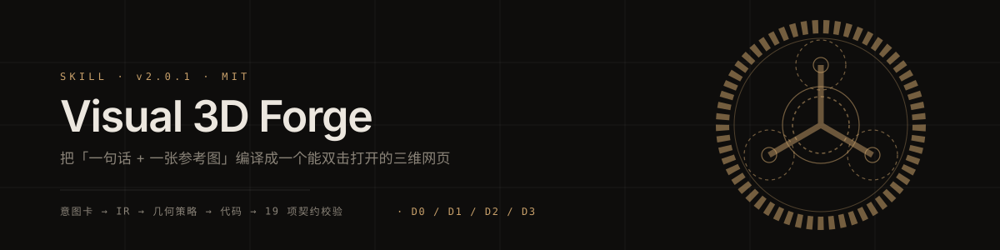
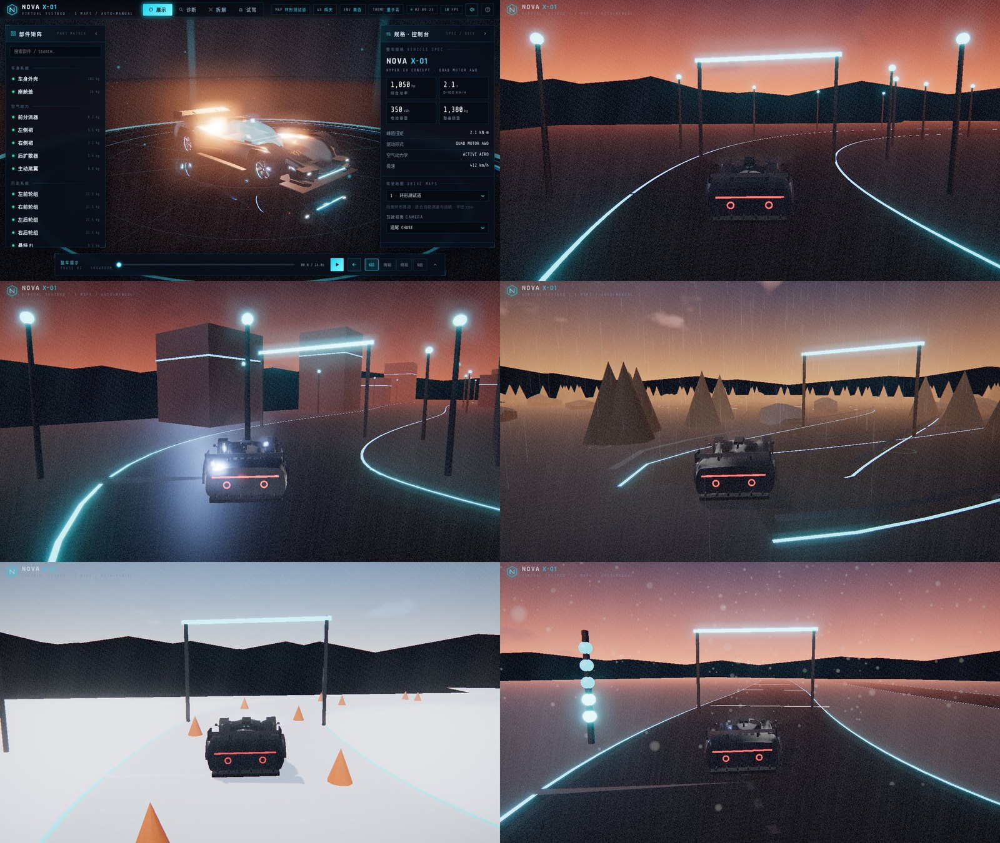
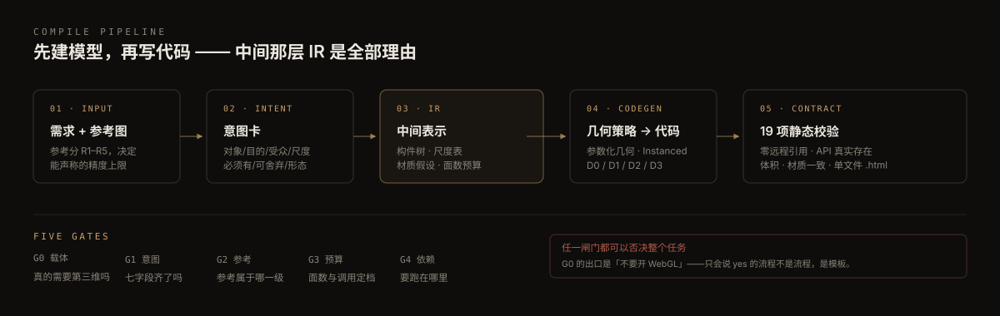
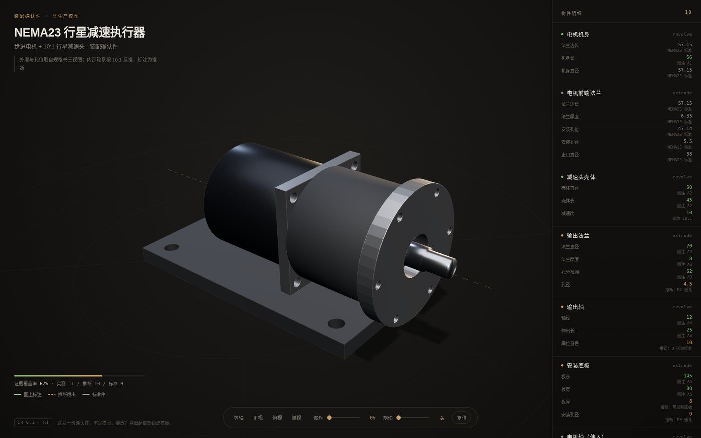
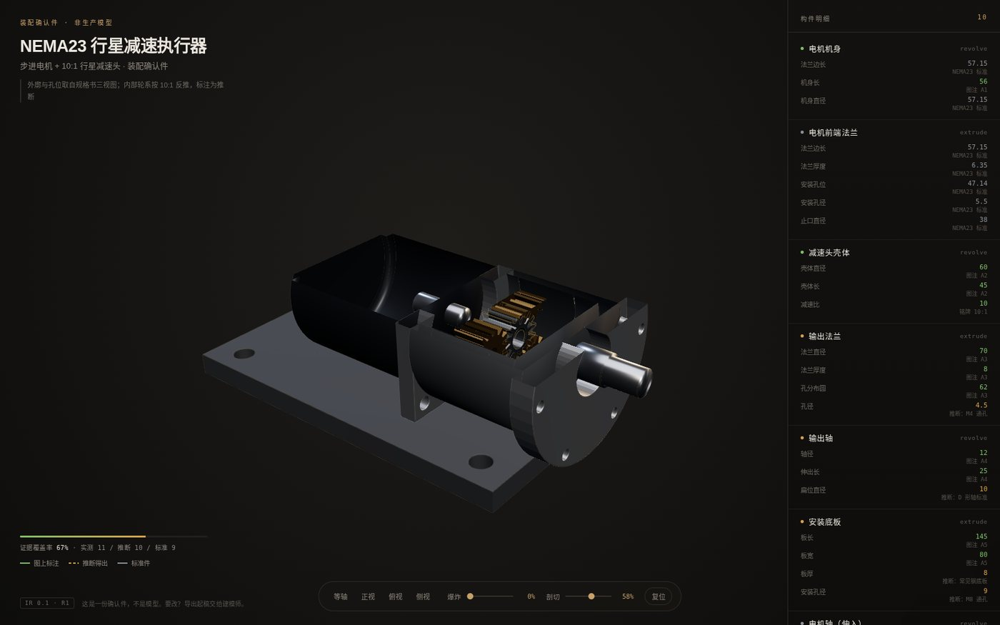
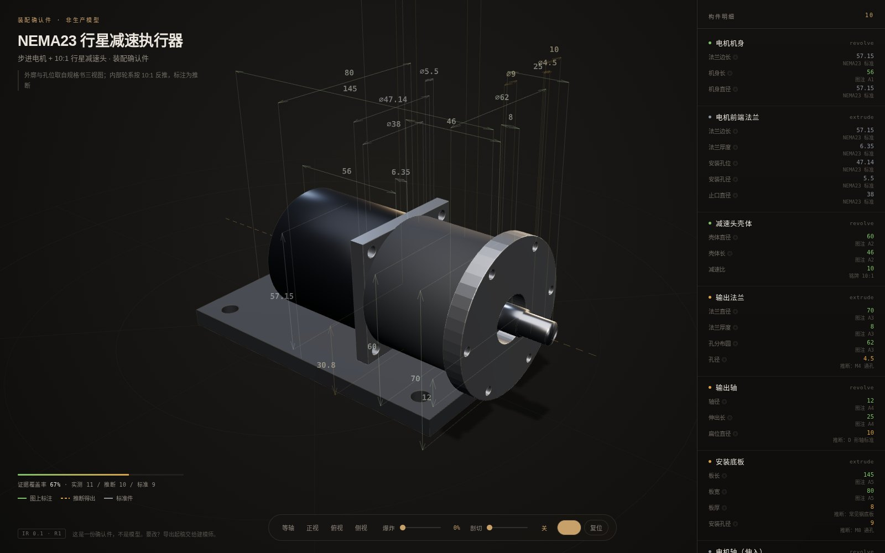
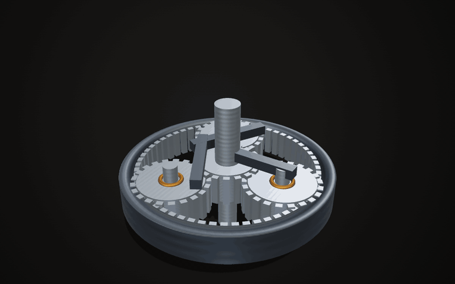

<p align="center">
  
</p>

<h3 align="center">When AI builds 3D, it fails the same way every time: <em>it spins, but it isn't the object.</em></h3>

<p align="center">
  <a href="https://github.com/LucasDevKid9/visual-3d-forge/actions/workflows/ci.yml"></a>
  <a href="LICENSE"></a>
  
  
  
</p>

<p align="center">
  <a href="https://lucasdevkid9.github.io/visual-3d-forge/"><b>▶ Live · NOVA X-01 — a five-scene virtual testbed, drive it in the browser</b></a>
</p>

<p align="center">
  <a href="https://lucasdevkid9.github.io/visual-3d-forge/">
    
  </a>
</p>

<p align="center">
  <sub>NOVA X-01 · 673 KB single file · double-click to open, no server, no network · 5 scenes / 4 times of day / 3 weathers</sub>
</p>

---

## The problem isn't the model. It's the missing representation.

Jumping straight from a sentence to `new THREE.Mesh(...)` skips a layer:

> **What parts is this made of? How big is each one? What material? Who guarantees the dimensions agree with each other?**

Without that layer, the model can only reach for the most similar template in its training distribution — which is why everything comes out as the same smooth box. It turns. It just isn't a *thing that was built*.

This skill inserts an **IR** (intermediate representation) in the middle. It doesn't write prompts. It **compiles**:

<p align="center">
  
</p>

**Model first, code second.** That is the one ordering rule that cannot be negotiated — because it is the only one that explains *why it looks right*.

---

## How it differs from "just ask GPT for three.js"

| | Direct code generation | Visual 3D Forge |
|---|---|---|
| Intermediate artifact | none | part tree + dimension table + material assumptions |
| Where dimensions come from | "roughly this" from training | one dimension table, everything derives from it |
| Reference image | "make it like this" | R1–R5 grading that caps the **claimable precision** |
| Failure mode | blank page / all black / clipping | 19 static contract checks with a fix direction |
| Can it say no? | never | **5 gates, any of which can veto the task** |
| Deliverable | a snippet | a `.html` you double-click |

That last row matters: a pipeline that only ever says yes isn't a pipeline, it's a template. **G0's exit condition is "don't open WebGL"** — if the goal is merely to make a page move, CSS is the more correct answer.

---

## Spec Compiler: a dimensioned drawing in, a spinnable confirmation out

NOVA answers "what can this pipeline make". Spec Compiler answers "how does a **spec** become something you can spin".

It does not model — it **confirms**. The gap it fills sits before modelling starts, and today it has no tool:

```
concept -> spec -> [confirm] -> model -> render -> deliver
                      ^
                 nothing here
```

Blender amplifies a person's craft. What this deletes is the *translation* step. A human only **identifies** — what part is this, which numbers, where it mounts. Placement is solved from the assembly chain; geometry comes from five primitives (revolve / extrude / gear / pattern / hole).

<p align="center">
  <a href="https://lucasdevkid9.github.io/visual-3d-forge/spec/out/nema23-actuator.html"><b>▶ Open this confirmation page live — spin it, section it, explode it</b></a>
</p>

<p align="center">
  
</p>

Every number carries provenance, and the viewport says so:

| Grade | Meaning | On screen |
|---|---|---|
| **measured** | dimensioned on the drawing | green edge, hover shows the callout id |
| **standard** | NEMA / GB / ISO | grey edge, shows the standard |
| **inferred** | derived from proportion, symmetry or priors — **not on the drawing** | amber edge, hover shows the basis |

No modelling tool tells you "I guessed this number", because that is bad for selling software. The person signing off cares about exactly that sentence.

<p align="center">
  
</p>

### Every number is pinned to the segment it measured

<p align="center">
  
</p>

"Has a basis" is unfalsifiable if it stays a sentence. So the compiler **nails each dimension back onto geometry**: it measures the bounding box, the profile segments, the hole spacing — and anything it cannot nail down is reported as unlocated.

```
  body length   56.0  →  motor_body X span 56.00              ✓
  body diameter 57.15 →  motor_body radial diameter 57.15     ✓
  flat diameter 10.0  →  2r of the r=5.0 segment in profile   ✓
  hole diameter 5.5   →  the four ⌀5.5 holes in motor_flange  ✓
  hole circle   62.0  →  centre-to-centre of six holes 62.00  ✓
  tooth count   16    →  dimensionless, excluded from the denominator
```

On the page these anchors become real dimension lines: extension lines, arrowheads, values, coloured by grade. Hover a part and its dimensions light up; click a row in the side panel and the camera flies in until that one segment is all that is left.

> The chain catches its own mistakes. Its first run reported "shell length says 45, geometry says 46" — two numbers, both plausible, one inconsistent. **That class of error is invisible in a render.**

```bash
python3 tools/spec_compile.py spec/examples/nema23-actuator.yaml --out spec/out/
```

Three artefacts: a **confirmation page** (single HTML, opens offline), a **conformance report** (IR + printable page), and the **IR itself** (for glTF export later).

Compile the same SpecSheet twice and the fingerprint must match — that assertion lives in `tests/test_spec.py`: change one number and the hash changes; change nothing and it never does.

- Input contract: [`spec/schema/specsheet.schema.json`](spec/schema/specsheet.schema.json)
- Example: [`spec/examples/nema23-actuator.yaml`](spec/examples/nema23-actuator.yaml)
- Roadmap: [`docs/ROADMAP.md`](docs/ROADMAP.md) — 26 weeks, four stages, one falsifiable gate each
- Delivery standard: [`docs/PRINCIPLES_EN.md`](docs/PRINCIPLES_EN.md) — ten principles plus a red-line checklist you can fail
- Document map: [`docs/README.md`](docs/README.md) — bilingual index and reading order

---

## Flagship demo: NOVA X-01

That image is not a render. It is a screenshot of a **673 KB HTML file**.

Open it and you get a procedurally generated concept car, five switchable scenes, four times of day, three weathers, an exploded-part view and a spec console. 60 fps. No textures, no model files, no build step.

**Why it deserves its own demo:**

| Typical demo | This one |
|---|---|
| One model, rotating | Five scenes, each with its own lighting and atmosphere |
| Proves "it can generate" | Proves "quality holds when the scene changes" |
| Source and output mixed together | **Output only, no source** — it is what the compiler emits, not a template to copy |

The artifact lives at [`demo/index.html`](demo/index.html). Source is not distributed, and that is deliberate: **the deliverable is the artifact, not the source.**

| # | Scene | What it validates |
|---|---|---|
| 1 | Showroom | Seamless cyclorama, exposure ladder, part matrix, exploded view |
| 2 | Ring track | Corner following, low chase cam, continuous lighting |
| 3 | City at night | Block occlusion, wet reflections, night bloom |
| 4 | Mountain pass | Terrain relief, distant layering, rain fog falloff |
| 5 | Snow field | Low-grip surface, cone slalom, high-albedo ground |
| 6 | Drag strip | Speed feel, telephoto compression, braking distance |

Press `N` for map, `C` for camera, `T` for time, `F` for weather, `Space` to explode. Or append `?tour=1` to the URL and it cuts all five scenes into one reel.

---

## Live playground: change a number, watch the constraints bite

[**lucasdevkid9.github.io/visual-3d-forge/playground/**](https://lucasdevkid9.github.io/visual-3d-forge/playground/)

<p align="center">
  
</p>

Not a screen recording — the real thing:

- Drag module / sun teeth / ring teeth and the **geometry is genuinely rebuilt** (not scaled)
- Three assembly constraints checked live: **concentric** (z₂ must be an integer), **assembly** ((z₁+z₃) divisible by 3), **adjacency** (planets must not collide)
- Violate one and the scene **refuses to rebuild** — it stays on the last legal state and offers a one-click correction to the nearest valid tooth count
- Click any part for its role and material; contact ratio εα computed from the transverse contact formula

It will refuse you, on purpose, at least once. That moment explains the project better than any paragraph.

---

## Four delivery modes

| Mode | Output | Measured size | Network | When |
|---|---|---|---|---|
| **D0** | one `.html` | 13 KB | CDN | **default** |
| **D1** | one `.html` | 2852 KB | none | offline / air-gapped / USB stick |
| **D2** | `.html` + `vendor/` | 13 KB + 2391 KB | none | you want readable source |
| **D3** | React Three Fiber project | npm | build chain | integrating into a React app |

The mode is chosen by the **runtime environment**, not by which sounds better. If you declare D1, there must be zero external requests — the validator counts every URL.

---

## Up and running in three minutes

```bash
git clone https://github.com/LucasDevKid9/visual-3d-forge.git
cd visual-3d-forge

# 1. Start from a scaffold — never hand-write the pipeline in an empty file
cp assets/scaffold/forged-scene.html ./my-scene.html

# 2. Describe your object (you edit the dimension table and part tree, not ad-hoc meshes)
#    Rules: references/03-geometry-modeling.md

# 3. Bundle to a single offline file, then run the contract
python3 scripts/bundle.py --src ./my-scene.html --out ./offline.html --vendor ./assets/vendor
python3 scripts/validate_scene.py ./offline.html --strict
```

All three must be green before you ship. Measured: 13.3 KB source → 2851.5 KB single file, 19/19 checks, zero remote references.

> To use as an AI skill: drop the whole directory into your host's `skills/`, with `SKILL.md` at its root.

---

## Four tools, zero third-party dependencies

| Script | What it does | The part that's actually hard |
|---|---|---|
| `vendor.py` | Prunes the three.js import closure | recursive resolution of addon-relative imports, sha256 manifest |
| `bundle.py` | Inlines vendor into one file | **a dependency imported once and re-exported once must reuse its specifier** — otherwise: white screen |
| `api_lookup.py` | Checks whether an API really exists | 488-symbol table, set difference against the artifact, nearest correct name |
| `validate_scene.py` | Pre-delivery static audit | 19 checks (D1) / 18 (D0, D2); `--strict` turns warnings into failures |

The `bundle.py` row isn't hypothetical. v2.0 died exactly there: `three.module.js` both `import`s and `export ... from './three.core.js'`, the second pass minted a never-registered `vf-int-2`, and the browser refused the whole module graph. There's a dedicated regression fixture on it now.

---

## Contracts, not documentation

```bash
python3 -m pytest tests/ -q     # 149 passed
```

Every number in this README has an assertion that can falsify it in under ten seconds:

| Layer | What is asserted |
|---|---|
| **Docs** | frontmatter fields, index ↔ files bidirectional, no placeholders, no local absolute paths |
| **Deps** | all 18 manifest files re-hashed, three `REVISION = 187`, importmap points local |
| **Tools** | every script's `--help` and `--self-test`, stdlib-only imports |
| **End-to-end** | D0/D2 scaffolds pass 18 → bundle to D1 → 19/19 → zero remote refs → size within 2.0–4.0 MB |
| **Negative** | remove the importmap: default warns only, `--strict` must go red; remove an import: must go red |
| **Presentation** | playground importmap resolves file-by-file, solver predicates present, SVGs script-free, GIF is animated |

The negative cases are the point. **A test suite that only checks the happy path is not a test suite.**

---

## Ten red lines (hitting one disqualifies the output)

> precision lies · API hallucination · material split · metalness-as-gloss · decorative physics ·
> default camera · perpetual orbit · uniform spin as motion design · particles as camouflage · inconsistent multi-view

They're written as negations because **a rule someone can point at and say "you broke this" is a rule that gets followed**.

---

## Honest limits

1. **Static checks cannot judge aesthetics.** 19/19 green ≠ good-looking.
2. **`api_lookup.py` needs the three.js source** (`npm pack three@0.187.0`). This package ships build artifacts only, so that gate is not runnable out of the box.
3. **No visual regression.** No pixel comparison against the reference. "Does it look like it" still needs a human.
4. **`vendor/` commits 2.4 MB of binaries** in exchange for zero-network, zero-build offline use. That's a trade, not a free lunch.
5. **The skill body is in Chinese.** English readers rely on this file and the code structure.
6. **D3 ships a scaffold and a trap list**, assuming you know React.
7. **The playground's teeth are box approximations**, not involute profiles. Tooth counts, pitch circles, centre distance and ratio are real; the tooth flank is not.

---

## Repository layout

```
visual-3d-forge/
├── SKILL.md              contract, five gates, six phases, algorithm index (skill entry)
├── references/           13 phase-scoped references (3033 lines: geometry / materials / algorithms / R3F / API verification)
├── assets/
│   ├── vendor/           pruned three r187 set, 18 files (2.4 MB, hashed manifest)
│   └── scaffold/         D0 / D2 / D3 scaffolds
├── scripts/              four tools, stdlib only
├── demo/                 flagship NOVA X-01 (build artifact, 673 KB single file; source not distributed)
├── playground/           live parametric playground (gear solving + live rebuild)
├── examples/             runnable example (planetary gearbox)
├── spec/                 SpecSheet schema, compiler, runtime, examples, build output
├── tools/                spec_compile.py: YAML → IR → single-file deliverable
├── guide/                the human-facing layer: five fillable templates, one worked example
├── docs/                 architecture, design notes, validation record, banner, pipeline diagram
├── tests/                149 contract tests, including negative cases
└── THIRD-PARTY-NOTICES.md
```

---

## Docs

**Start here if it is your first time**: [Guide: from a drawing to a deliverable](guide/README.md) — a brief, a decoding sheet, a spec template, an acceptance gate, a diagnostic table, and one worked example with its mistakes left in.

- [Principles: ten rules and a red-line checklist](docs/PRINCIPLES_EN.md) — [中文](docs/PRINCIPLES.md)
- [Roadmap: 26 weeks, four stages, one falsifiable gate each](docs/ROADMAP_EN.md) — [中文](docs/ROADMAP.md)
- [Strategy: moats, algorithm order, market order](docs/STRATEGY-2026_EN.md) — [中文](docs/STRATEGY-2026.md)
- [Document map and reading order](docs/README.md)
- [Architecture: why this is a compiler, not a prompt](docs/ARCHITECTURE.md)
- [Design notes: eleven decisions and their counterexamples](docs/DESIGN-NOTES.md)
- [Validation record: what each of the 149 assertions guards against](docs/VALIDATION.md)
- [中文 README](README.md)

## License

MIT — see [LICENSE](LICENSE). Bundled three.js is MIT; see [THIRD-PARTY-NOTICES.md](THIRD-PARTY-NOTICES.md).
